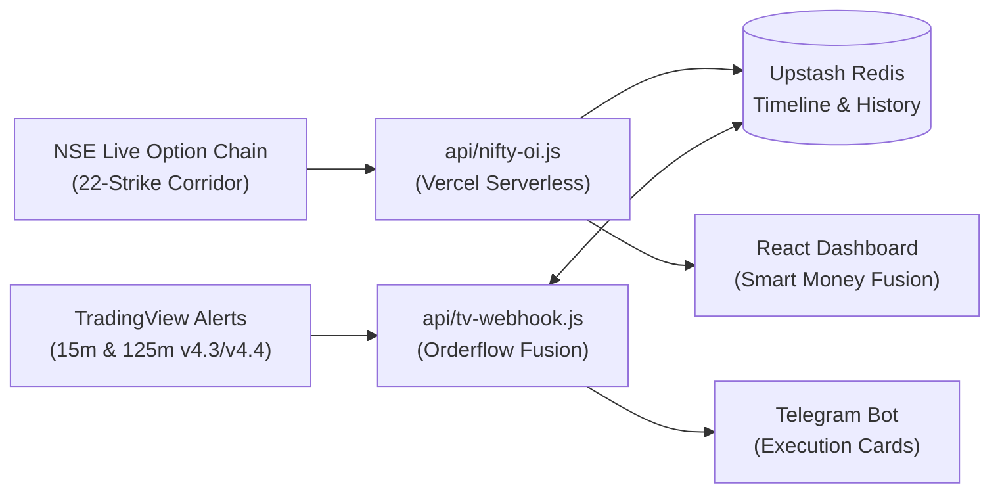

# OptionsScanner — Smart Money Fusion & Derivatives Intelligence Platform

Institutional-grade NIFTY 50 options orderflow analytics, real-time TradingView webhook fusion engine, and swing scanner dashboard.

---

## 📚 Complete System Documentation & Specifications

Detailed engineering specs, mathematical formulations, and audit logs are preserved in [`docs/`](docs/):

1. **[System Architecture & Mathematical Specification](docs/SYSTEM_ARCHITECTURE_AND_MATHEMATICAL_SPECIFICATION.md)**  
   *Cost-of-carry fair basis formula, 4-quadrant futures flow, 22-strike ATM corridor $\Delta\text{PCR}$, Wilson 95% confidence intervals, capped stop loss ($1.8\times\text{ATR}$), target ladder, and Redis dynamic TTL.*
2. **[Conversation History & Audit Log](docs/CONVERSATION_HISTORY_AND_AUDIT_LOG.md)**  
   *Chronological engineering log, 3rd-party audit resolution, exit priority fixes, Monday Nov 9 125m Bear Synergy (SL 25,236) deep-dive, and Wednesday market scenario roadmaps.*
3. **[Session Handover & Continuity Guide](docs/SESSION_HANDOVER_AND_CONTINUITY_GUIDE.md)**  
   *Quickstart commands for switching laptops, environment variables checklist, TradingView webhook configuration, and the instant AI handover prompt.*
4. **[Frozen Performance Baseline (Nov 9, 2026)](docs/frozen_baseline_nov9_2026.md)**  
   *Audited benchmark metrics across 15m (Intraday), 125m (Swing), and Daily (1D) timeframes.*
5. **[7-Year Historical Audit & Optimization Blueprint](docs/seven_year_audit_and_80pct_optimization_blueprint.md)**  
   *Multi-cycle backtest across 2019–2026 (1,733 Daily bars & 5,079 Hourly bars).*
6. **[Full Architecture Validation Report](docs/architecture_validation_report.md)**  
   *End-to-end audit of data pipelines, repainting risks, and edge analysis.*

---

## 🎯 Architecture Overview



---

## 🧪 Automated Testing & Verification

```bash
# Run full unit and end-to-end integration test suite (72/72 tests passing)
npm test

# Verify 100% delimiter and syntax balance in active Pine Scripts
node test/check_pine_syntax.cjs
```

---

## 📁 Repository Structure

- `src/` — React frontend, including `NiftyFlowView.jsx` Smart Money Fusion UI.
- `api/` — Serverless backend (`tv-webhook.js`, `nifty-oi.js`).
- `strategy_dashboard_v4_3_real_oi.pine` — Active production TradingView indicator.
- `strategy_dashboard_v4_4_backtest_strategy.pine` — Active production backtest strategy.
- `docs/` — Specifications, benchmarks, audit logs, and handover guides.
- `archive/` — Historical Pine scripts (`v3.4` through `v4.2`).
- `test/` — Unit tests, E2E simulations, and historical tick data.

---

## What this is

A React app built with Vite that:
- Fetches Google Sheets data (published as CSV) and live NSE Option Chain derivatives
- Scores 200+ F&O stocks based on Inside Day, Inside Value, Confluence Pivots, and Compression Ratio signals
- Auto-refreshes every 15 minutes
- Shows nightly Swing Scanner Tier, Rank, RS, Volume, Trend, and Base scores when present
- Prioritizes Inside Day/Inside Value stocks confirmed by strong Tier, Trend, or Rank
- Features light/dark theme toggle
- Works on mobile and desktop

## Deploy in 10 minutes

### Option 1 — Vercel (recommended, easiest)

1. Go to https://vercel.com and sign up with GitHub (free)
2. Create a new GitHub repository called `options-scanner`
3. Upload all files from this folder to that repo
4. In Vercel, click **"Add New Project"** → import your repo
5. Vercel auto-detects Vite — click **"Deploy"**

## Run locally first

```bash
npm install
npm run dev
```

Open http://localhost:5173 — loads with live data.
