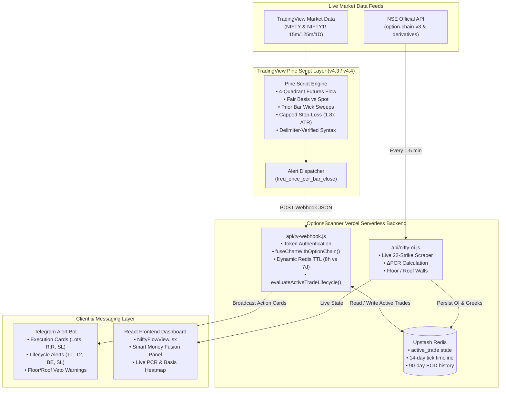
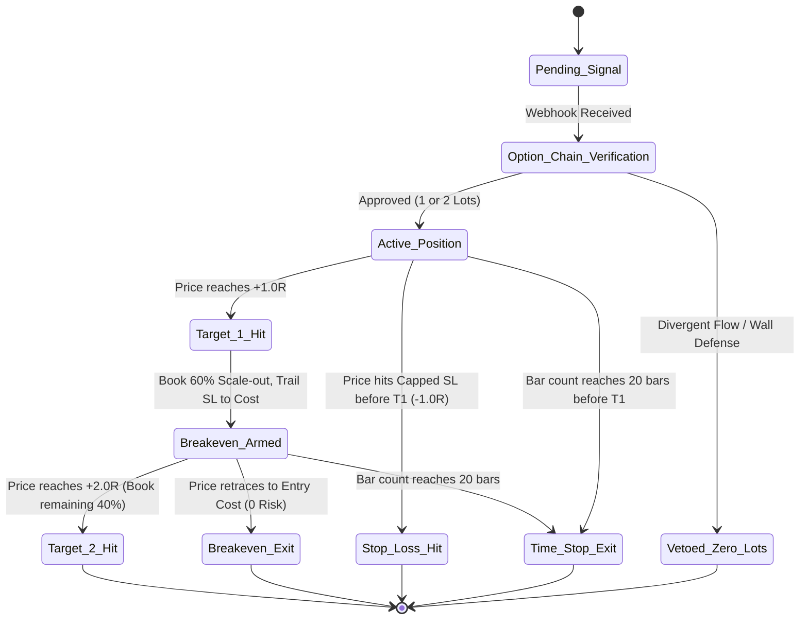

# 📐 System Architecture & Mathematical Specification
## OptionsScanner & Smart Money Fusion Trading Engine

> **Version**: 4.4 Enterprise / Quant Grade  
> **Last Updated**: 10 November 2026  
> **Coverage**: Multi-Timeframe (15m Intraday, 125m Swing, Daily Structural)  
> **Repository**: `OptionsScanner` (`cskchankrish/OptionsScanner`)

---

## 1. High-Level Architecture Overview

The system operates across two decoupled, complementary layers:
1. **Client / Execution Overlay (TradingView Pine Script v6)**:
   - Evaluates price action, high-timeframe structural regime, volatility sweeps, and futures basis velocity.
   - Emits Webhook alerts containing real-time bar timestamps, setup types, entry price, capped stop loss, and target levels.
2. **Server / Orderflow Fusion Core (Node.js Serverless + Upstash Redis + NSE Scraper)**:
   - Scrapes live 22-strike NSE Option Chain derivative data (`option-chain-v3` + `liveEquity-derivatives`).
   - Maintains continuous historical state across sessions (14-day timeline, 90-day EOD record).
   - Validates all TradingView signals against live institutional OI before trade authorization.
   - Dispatches formatted execution cards and lifecycle state transitions to Telegram.

---

## 2. Complete Mathematical Formulations

### 2.1 Fair Cost-of-Carry Futures Basis
Futures trade at a premium or discount to spot depending on the cost of carry (interest rate minus dividend yield).
$$\text{Fair Basis} = \text{Spot} \times r \times \frac{\text{DTE}}{365}$$
Where:
- $\text{Spot}$: Live NIFTY 50 Index cash price.
- $r$: Risk-free benchmark rate ($5.2\% = 0.052$).
- $\text{DTE}$: Days to contract expiry ($\text{Expiry Date} - \text{Current Date}$).

### 2.2 Intraday Basis Delta
Measures whether smart money is paying an expanding premium (aggressive institutional buying) or aggressive discount (institutional liquidation) relative to the session open:
$$\text{Intraday Basis} = \text{Futures Close} - \text{Spot Close}$$
$$\Delta\text{Basis} = \text{Intraday Basis}_{\text{current}} - \text{Intraday Basis}_{\text{session\_open}}$$
- **Bullish Basis Shift**: $\Delta\text{Basis} \ge +5.0\text{ pts}$ (Futures expanding faster than spot).
- **Bearish Basis Shift**: $\Delta\text{Basis} \le -5.0\text{ pts}$ (Futures compressing relative to spot).

### 2.3 4-Quadrant Futures Flow Classification
Institutional futures positioning is categorized into four distinct regimes by evaluating price direction and cumulative open interest change:
$$\Delta P = P_t - P_{\text{open}}, \quad \Delta OI = OI_t - OI_{\text{open}}$$

$$\text{Quadrant} = \begin{cases}
\text{LONG\_BUILDUP} & \text{if } \Delta P > 0 \text{ and } \Delta OI > 0 \\
\text{SHORT\_BUILDUP} & \text{if } \Delta P < 0 \text{ and } \Delta OI > 0 \\
\text{LONG\_UNWINDING} & \text{if } \Delta P < 0 \text{ and } \Delta OI \le 0 \\
\text{SHORT\_COVERING} & \text{if } \Delta P > 0 \text{ and } \Delta OI \le 0
\end{cases}$$

### 2.4 22-Strike Real Option Chain Corridor & $\Delta\text{PCR}$
Rather than evaluating total market PCR (which is distorted by far-out-of-the-money illiquid strikes), the system evaluates an ATM-centered corridor of 22 strikes ($\pm 11$ strikes from spot, spanning approximately $\pm 550$ points):

$$\Delta\text{PCR} = \frac{\sum_{i=-11}^{+11} \Delta OI_{\text{Put}, i}}{\sum_{i=-11}^{+11} \Delta OI_{\text{Call}, i}}$$

#### Safe Division & Singularity Handling:
$$\Delta\text{PCR}_{\text{safe}} = \begin{cases}
2.50 & \text{if } \sum \Delta OI_{\text{Call}} \le 0 \text{ and } \sum \Delta OI_{\text{Put}} > 0 \quad (\text{Pure Call Unwinding / Heavy Put Writing}) \\
0.10 & \text{if } \sum \Delta OI_{\text{Put}} \le 0 \text{ and } \sum \Delta OI_{\text{Call}} > 0 \quad (\text{Pure Put Unwinding / Heavy Call Writing}) \\
1.00 & \text{if } \sum \Delta OI_{\text{Call}} \le 0 \text{ and } \sum \Delta OI_{\text{Put}} \le 0 \quad (\text{Two-way Unwinding / Neutral}) \\
\frac{\sum \Delta OI_{\text{Put}}}{\sum \Delta OI_{\text{Call}}} & \text{otherwise}
\end{cases}$$

#### Institutional Flow Regimes:
- **Put Blitz (Aggressive Floor Building)**: $\Delta\text{PCR} \ge 1.30$ (Put writers dominate Call writers by $>30\%$).
- **Call Blitz (Aggressive Ceiling Building)**: $\Delta\text{PCR} \le 0.70$ (Call writers dominate Put writers by $>30\%$).
- **Balanced Corridor / Churn**: $0.70 < \Delta\text{PCR} < 1.30$.

### 2.5 Institutional Support (Floor) & Resistance (Roof)
$$\text{Floor Strike} = \operatorname{argmax}_{K \in \text{Corridor}} \left(OI_{\text{Put}}(K)\right)$$
$$\text{Roof Strike} = \operatorname{argmax}_{K \in \text{Corridor}} \left(OI_{\text{Call}}(K)\right)$$
$$\text{Distance to Floor} = \text{Spot} - \text{Floor Strike}$$
$$\text{Distance to Roof} = \text{Roof Strike} - \text{Spot}$$

---

## 3. Signal Mechanics & Mathematical Definitions

### 3.1 Sweep & Trap Logic

#### Bear Trap (Bullish Reversal):
1. **Liquidity Sweep**: Current bar low pierces the lowest low of the prior $N$ bars ($N=3$ default):
   $$\text{Low}_t < \min_{1 \le k \le N}(\text{Low}_{t-k})$$
2. **Rejection & Close Inside**: Current bar closes above that prior low, proving seller exhaustion:
   $$\text{Close}_t > \min_{1 \le k \le N}(\text{Low}_{t-k})$$
3. **Flow Filter**: Bullish futures flow or basis expansion ($\Delta\text{Basis} \ge +5$).

#### Bull Trap (Bearish Reversal):
1. **Liquidity Sweep**: Current bar high pierces the highest high of the prior $N$ bars:
   $$\text{High}_t > \max_{1 \le k \le N}(\text{High}_{t-k})$$
2. **Rejection & Close Inside**: Current bar closes below that prior high, proving buyer exhaustion:
   $$\text{Close}_t < \max_{1 \le k \le N}(\text{High}_{t-k})$$
3. **Flow Filter**: Bearish futures flow or basis compression ($\Delta\text{Basis} \le -5$).

### 3.2 Synergy Verification (Pine Proxy vs Backend Option Chain)
- **In TradingView ("Auto Mode")**:
  - `Bull Synergy`: $\text{Price} > \text{Open}$ AND $\text{Futures} = \text{LONG\_BUILDUP}$ AND $\Delta\text{Basis} \ge +5$.
  - `Bear Synergy`: $\text{Price} < \text{Open}$ AND $\text{Futures} = \text{SHORT\_BUILDUP}$ AND $\Delta\text{Basis} \le -5$.
- **In Backend (`api/tv-webhook.js`)**:
  - Webhook intercepts `SYNERGY_BEAR` or `SYNERGY_BULL` and queries live NSE Option Chain.
  - **Veto Bear Synergy** if $\Delta\text{PCR} > 1.05$ OR $(\text{Distance to Floor} \le 80\text{ pts and } \Delta\text{PCR} \ge 0.85)$.
  - **Veto Bull Synergy** if $\Delta\text{PCR} < 0.95$ OR $(\text{Distance to Roof} \le 80\text{ pts and } \Delta\text{PCR} \le 1.15)$.
  - **Authorize High Conviction (2 Lots)** if $\Delta\text{PCR} \le 0.75$ (for Bear) or $\Delta\text{PCR} \ge 1.30$ (for Bull).

---

## 4. Risk Budgeting, Capping & Execution State Machine

### 4.1 Capped Stop Loss Formulation
To eliminate tail risk and outlier ATR expansions, raw swing stops are bounded by a dynamic 15-minute ATR cap:
$$\text{Max Risk Distance} = 1.8 \times \text{ATR}_{14}(15\text{m})$$

For Long Trades:
$$\text{Raw SL} = \min_{1 \le k \le 3}(\text{Low}_{t-k}) - 0.35 \times \text{ATR}_{14}$$
$$\text{Capped SL} = \max(\text{Raw SL}, \text{Entry} - \text{Max Risk Distance})$$
$$\text{Risk Points } (R) = \text{Entry} - \text{Capped SL}$$

For Short Trades:
$$\text{Raw SL} = \max_{1 \le k \le 3}(\text{High}_{t-k}) + 0.35 \times \text{ATR}_{14}$$
$$\text{Capped SL} = \min(\text{Raw SL}, \text{Entry} + \text{Max Risk Distance})$$
$$\text{Risk Points } (R) = \text{Capped SL} - \text{Entry}$$

**Strict Zero-Risk Guard**: Every order requires $R > 0$. If $R \le 0$, order dispatch is aborted.

### 4.2 Target Calculations & Scale-Out Math
$$\text{Target 1 (1.0R Floor)} = \text{Entry} \pm \max(1.0 \times R, \text{Structural S/R})$$
$$\text{Target 2 (2.0R Runner)} = \text{Entry} \pm \max(2.0 \times R, \text{Structural S/R})$$

### 4.3 Exit State Machine Priority
During bar evaluation, exits are processed in strict sequential priority:
1. **Target 2 Hit**: $\text{High} \ge T_2$ (Long) or $\text{Low} \le T_2$ (Short) $\implies$ Close remaining 40% at $T_2$, mark trade complete.
2. **Stop Loss Hit**: $\text{Low} \le \text{SL}$ (Long) or $\text{High} \ge \text{SL}$ (Short) $\implies$ Close at $\text{Capped SL}$, book loss.
3. **Time-Stop Exit**: Active bar count $\ge 20$ bars (5 hours on 15m) $\implies$ Close at current Bar Open.
4. **Breakeven Exit**: If $T_1$ was reached, SL is trailed to $\text{Entry}$. If price retraces to $\text{Entry}$, exit at cost ($0.0R$).

---

## 5. Statistical Rigor: Wilson Score & Expectancy Formulation

### 5.1 Wilson Score 95% Confidence Interval
Normal approximation $\hat{p} \pm 1.96\sqrt{\frac{p(1-p)}{n}}$ fails on small-to-medium samples. We calculate the exact asymmetric Wilson Score interval:
$$CI_{95\%} = \frac{\hat{p} + \frac{z^2}{2n} \pm z\sqrt{\frac{\hat{p}(1-\hat{p})}{n} + \frac{z^2}{4n^2}}}{1 + \frac{z^2}{n}}, \quad \text{where } z = 1.95996$$

### 5.2 Required Breakeven Win Rate
$$\text{Friction} = 4.0\text{ points (round-trip brokerage, slippage, STT)}$$
$$P_{\text{breakeven}} = \frac{1}{1 + \frac{\text{Avg Win}}{\text{Avg Loss} + \text{Friction}}}$$

### 5.3 Mathematical Expectancy ($E$)
$$E(R) = P(\text{Win}) \times \frac{\text{Avg Win}}{R} - P(\text{Loss}) \times \frac{\text{Avg Loss}}{R}$$
$$\text{Expectancy (pts/trade)} = P(\text{Win}) \times \text{Avg Win} - P(\text{Loss}) \times \text{Avg Loss} - \text{Friction}$$

---

## 6. Multi-Timeframe Holding & Redis Dynamic TTL

| Timeframe | Setup Type | Typical Duration | Redis TTL | Rationale |
| :--- | :--- | :---: | :---: | :--- |
| **15m** | Intraday Trap / Synergy | 1 to 5 hours | **28,800 sec** (8 hours) | Must flush at session close; prevents stale intraday state. |
| **125m** | Multi-Day Swing / STBT / BTST | 1 to 3 days | **604,800 sec** (7 days) | Must survive market holidays (e.g. Diwali) and weekends. |
| **Daily (1D)** | Structural Positional Swing | 1 to 3 weeks | **604,800 sec** (7 days) | Persistent cross-week lifecycle tracking. |

All state transitions are atomically committed to `@upstash/redis` under key `tv_active_trade`.
